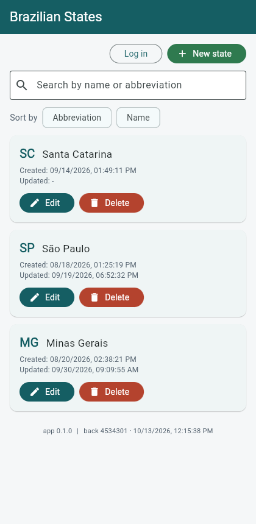
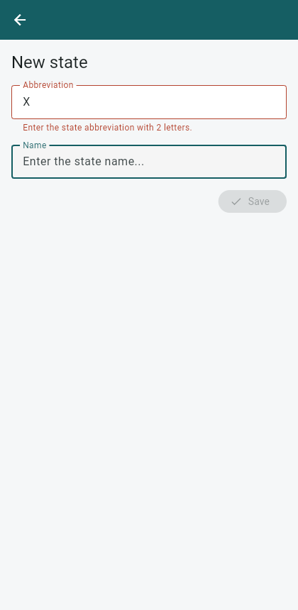

# flutter_state

[](https://github.com/ronybrand/flutter_state/actions/workflows/ci.yml)

CRUD for Brazilian federative units (states): abbreviation, name and created/updated timestamps.
It consumes the [Estado project](https://github.com/ronybrand/estado)'s REST API. This is the
**Flutter** client for that backend, a sibling of
[react_state](https://github.com/ronybrand/react_state) (Next.js),
[vue_state](https://github.com/ronybrand/vue_state) (Vue 3) and
[react_native_state](https://github.com/ronybrand/react_native_state) (Expo). The domain, the
validation rules, the messages and the API contract are the same; the app follows Flutter
conventions instead of the web or React Native ones.

## Screenshots




(Captured from the web build; on a device the widgets are the same, drawn by Flutter's own engine.)

## Stack

- Flutter 3.47 / Dart 3.13, Material 3
- [Riverpod 3](https://riverpod.dev/) for state and dependency injection
- [go_router](https://pub.dev/packages/go_router) for navigation and the auth guard
- [dio](https://pub.dev/packages/dio) with request-id, retry and 401 interceptors
- [flutter_secure_storage](https://pub.dev/packages/flutter_secure_storage) (Keychain / Keystore)
- `flutter_test` + [mocktail](https://pub.dev/packages/mocktail), `flutter_lints`

## What differs from the other clients, and why

| Web (react_state / vue_state)             | This app                                                                          |
| ----------------------------------------- | --------------------------------------------------------------------------------- |
| JWT in `localStorage`                     | `flutter_secure_storage`, mirrored in memory for the HTTP interceptor             |
| `/api` BFF proxy (CORS, CSP, IP forward)  | None: a native app has no origin and no CORS. `--dart-define=API_URL=...`         |
| Auth "loading" state, or a hydration gate | Token read **before `runApp`**: the app starts already knowing who is signed in    |
| Router guard that waits for auth          | `go_router` `redirect` + `refreshListenable`, re-run on every session change       |
| `State` type                              | `FederativeUnit`: `State` is Flutter's own `State<T>`                              |
| Table, `<dialog>` confirmation            | `ListView` + `RefreshIndicator`, `AlertDialog`                                    |
| axe-core accessibility run                | Flutter's built-in tap target, label and contrast guidelines on every screen       |
| Footer: frontend commit from version.json | App version from `pubspec.yaml` (`package_info_plus`)                              |

## Architecture

```
lib/
├── main.dart             # loads the token from the keychain, then runApp
├── app.dart, router.dart # MaterialApp.router; routes, guard, not-found
├── providers.dart        # tokenStore, dio, repositories, backend info, app version
├── theme.dart            # Material 3 theme with the palette shared by every client
├── core/                 # api_client (dio + interceptors), token_store, jwt, uuid, config,
│                           request_id, session_events, format_date
├── auth/                 # AuthController (Notifier) and ExpiryTimer
├── data/                 # FederativeUnit + anti-corruption mapping, validation,
│                           state/auth/info repositories
├── state/                # search, sort, list and detail providers, StateActions
├── screens/              # list, login, create, edit, not-found
└── widgets/              # StateForm, StateListItem, SortBar, ErrorBanner, AppFooter, FormPage, ...

test/                     # mirrors lib/; support/ holds fakes, mocks and the app harness
```

### Flutter conventions

- **Riverpod owns state; widgets stay thin.** `ConsumerStatefulWidget` only for local concerns
  (a text controller, the search debounce timer, an in-flight flag).
- **Riverpod 3 retries failed providers by default.** The HTTP client already retries GETs, so the
  `ProviderScope` sets `retry: (_, _) => null` to avoid multiplying attempts.
- **The list keeps its rows while a search or sort reloads.** Search and sort are providers the list
  provider watches; a rebuild exposes the previous value while loading (`isLoading` with a `value`),
  so there is no spinner flash per keystroke.
- **A failed first load shows the error and a "Try again" button**, never an empty-state message
  (it is not empty) and never a spinner that does not stop.
- **Dart `Timer` overflows on the web** past 2^31-1 ms (about 24.8 days) and fires at once, so the
  expiry timer clamps its delay and re-arms.
- **A form screen closes by popping the stack**, or lands on the list when opened cold (a deep link)
  and there is nothing to pop.
- **Accessibility is tested, not just intended**: `meetsGuideline(androidTapTargetGuideline)`,
  `iOSTapTargetGuideline`, `labeledTapTargetGuideline` and `textContrastGuideline` run on every
  screen; row actions carry labels like "Edit SP", errors are live regions, and the sort direction is
  read aloud.
- The backend's JSON contract (`sigla`, `nome`, ...) and the `/estado` path are the real wire
  contract and are **not** translated; `FederativeUnit.fromJson` is the anti-corruption layer.
- No async side effects (queues, notifications) exist in this client, so there is nothing to move
  off the request path.

## Running

```bash
flutter pub get
flutter run                                   # an emulator, a device or -d chrome
flutter run --dart-define=API_URL=https://api.example.com
```

`API_URL` is compiled into the binary (`String.fromEnvironment`), so it is readable by anyone with
the app: never put a secret there. It must be absolute `http(s)`; trailing slashes are dropped. The
default is the public deployment of the same API reached through the web app's proxy
(`https://react-state-flax.vercel.app/api`), fine for trying the app and not for anything else.
On an Android emulator the host machine is `http://10.0.2.2:<port>`; note that Android blocks
cleartext `http://` in release builds and iOS enforces ATS, so a real deployment must be `https`.

The Flutter web build calls the API from a browser, so it needs CORS on the backend (the native
builds do not).

Demo credentials (intentionally public): see the backend's README, also shown on the login screen.

## Scripts

```bash
flutter test               # 194 tests
flutter test --coverage    # about 96% of lines
flutter analyze --fatal-infos
dart format --set-exit-if-changed lib test
flutter build web --release
flutter build apk --debug  # needs the Android SDK
```

CI runs format, analyze, tests with coverage, a web build, an Android debug build and a Trivy scan.

## Development process

Built test-first (red, green, refactor): the specs for each layer were written and run failing
before the code they cover, and the history shows the red commits. Beyond `flutter test`, the web
build was driven end to end in a browser against the real API (list, search, sort, guard redirect,
login, validation) with accessibility switched on, so the controls were found through their
semantics. That is not a device run.

## Not done yet

- **A run on an Android emulator or an iOS device**, and device-level e2e (Patrol, `integration_test`
  or Maestro). The Android and iOS projects exist and CI compiles the Android one, but the app was
  exercised through widget tests and the web build.
- **Release signing, store assets and icons**: the launcher icon and splash are the template's.
- **CodeQL does not support Dart**, so there is no CodeQL workflow; Trivy covers dependencies,
  secrets and misconfiguration, and `flutter analyze` covers the code.

## Security

See [SECURITY.md](SECURITY.md).
